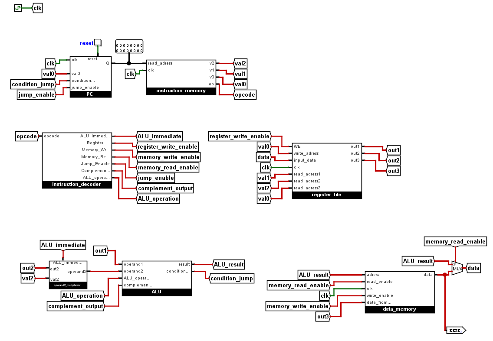
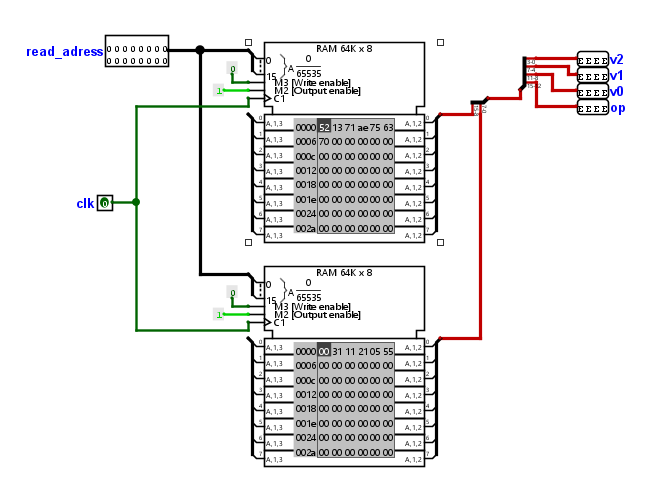

# CPU de 16 bits · Procesador monociclo

Diseño de un procesador monociclo con un conjunto de instrucciones propio, implementado en **Logisim-evolution**, acompañado por un ensamblador escrito en **Python** y programas de ejemplo.

**Autor:** Marcos Isaias Daubermann.



## El proyecto en pocas palabras

El recorrido va desde el diseño de la ISA y las señales de control hasta la construcción del procesador y la traducción de programas a hexadecimal.

- **Arquitectura de 16 bits:** instrucciones, registros y contador de programa.
- **16 registros**, con `r0` fijo en cero.
- **11 instrucciones:** operaciones aritméticas y lógicas, acceso a memoria y saltos condicionales.
- **Memorias separadas** para instrucciones y datos, implementadas mediante pares de RAM de 8 bits.
- **Ensamblador en Python** para traducir archivos `.tsm` a instrucciones hexadecimales `.x`.

## Empezar

### 1. Compilar un ejemplo

Necesitás **Python 3**, sin dependencias externas. Desde la raíz del repositorio:

```bash
cd compiler
python3 compiler.py
```

Cuando aparezca `Ingrese el nombre del archivo sin extensión:`, ingresá:

```text
sumatoria
```

El programa lee `programs/sumatoria.tsm` y escribe —o reemplaza— `bin/sumatoria.x`:

```text
5 2 0 0
1 3 3 1
7 1 1 1
a e 2 1
7 5 0 5
6 3 5 5
```

También podés ingresar `final` para compilar el otro ejemplo incluido. **Ejecutá siempre desde `compiler/`**: el programa usa rutas relativas al directorio de trabajo.

### 2. Explorar el procesador

Abrí [`hardware/CPU_Daubermann_Marcos.circ`](hardware/CPU_Daubermann_Marcos.circ) en **Logisim-evolution**. Versión utilizada: **3.8.0**.

El circuito principal es `main`. Desde allí podés recorrer el contador de programa, el banco de registros, la unidad de control, la ALU y las memorias.

La [guía de arquitectura](docs/arquitectura.md) presenta los componentes del procesador con sus diagramas y el detalle de la ISA.

## Estructura

```text
.
├── README.md
├── hardware/
│   ├── CPU_Daubermann_Marcos.circ
│   └── instrucciones_memoria/
│       ├── instrucciones_memoria1
│       └── instrucciones_memoria2
├── compiler/
│   ├── README.md
│   ├── compiler.py
│   ├── programs/
│   │   ├── sumatoria.tsm
│   │   └── final.tsm
│   └── bin/
│       ├── sumatoria.x
│       └── final.x
└── docs/
    ├── arquitectura.md
    └── images/
```

Las salidas `.x` permiten consultar la codificación hexadecimal de cada programa.

## Ejemplo: sumatoria

El programa suma desde cero hasta el valor almacenado en la dirección `0` de la memoria de datos y guarda el resultado en la dirección `10`.

```text
carga r2, r0, r0
suma r3, r3, r1
sumai r1, r1, 1
mayorig -2, r2, r1
sumai r5, r0, 5
almacena r3, r5, r5
```

Con `r1` y `r3` inicialmente en cero, el programa acumula la suma en `r3`. La última instrucción almacena ese valor en la dirección `r5 + r5 = 10`. El ejemplo combina cargas, aritmética, un salto relativo y almacenamiento.



## Documentación

- [Arquitectura e ISA](docs/arquitectura.md): componentes, diagramas y codificación de instrucciones.
