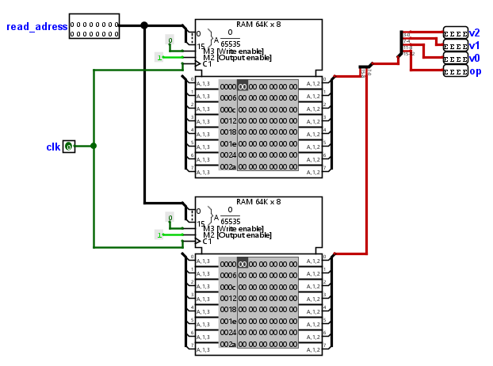
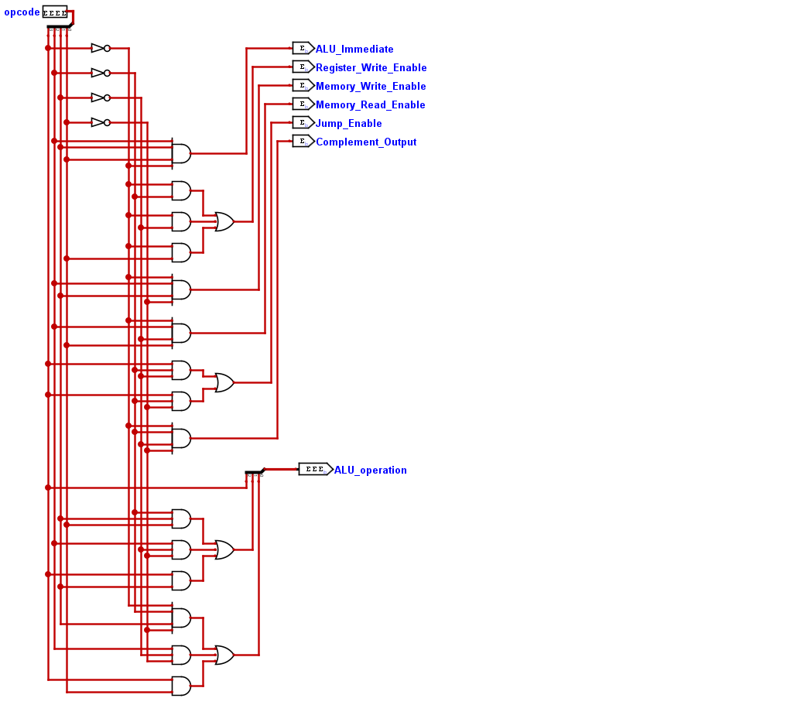
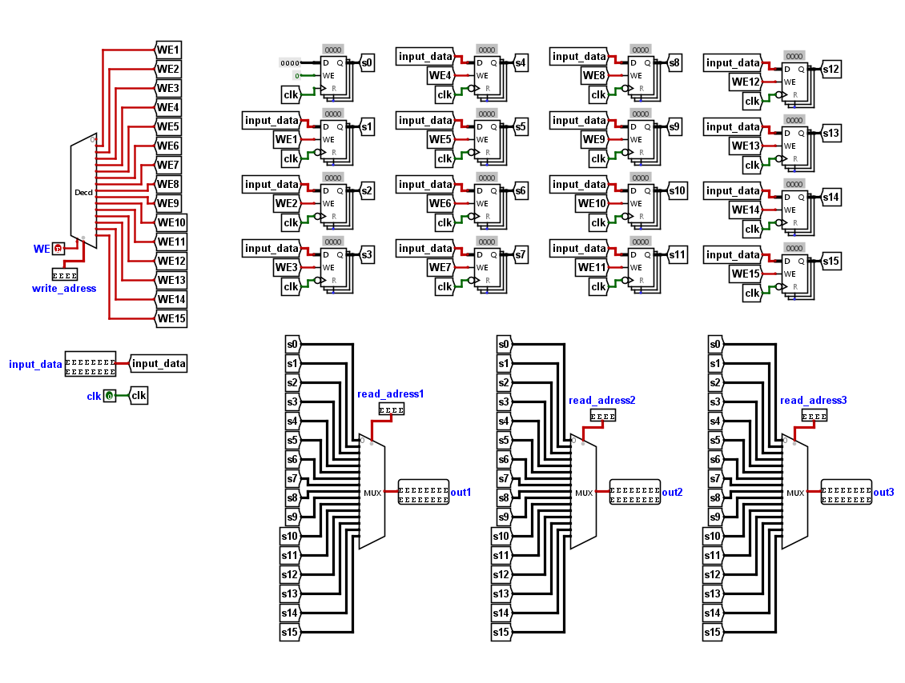

# Architecture and instructions

The processor combines a 16-bit ISA with a single-cycle design organized into subcircuits. This guide covers its components and program encoding.

## Components

| Component | Function |
| --- | --- |
| Program counter | 16-bit register; advances by one instruction or applies a relative offset. |
| Instruction memory | Two 8-bit RAM modules in parallel; provides the opcode and three operand fields. |
| Control unit | Decodes the opcode and generates write, read, branch, and ALU operation signals. |
| Register file | 16 registers of 16 bits each; `r0` remains zero. |
| ALU | Addition, subtraction, OR, AND, comparisons, and output inversion. |
| Data memory | Two RAM modules in parallel with read and write signals. |

The main circuit, `main`, connects the subcircuits. Control signals are simplified using Karnaugh maps.

## Encoding

Each instruction occupies **16 bits**, represented by four hexadecimal digits: a 4-bit opcode and three 4-bit fields.

| Format | Fields, from left to right |
| --- | --- |
| R | `opcode`, `rd`, `rf1`, `rf2` |
| I | `opcode`, `rd`, `rf1`, `inmediato` |
| J | `opcode`, `desplazamiento`, `rf1`, `rf2` |

Immediate values are written in decimal in the source code. To encode negative values in four bits, the assembler adds 16 before converting them to hexadecimal: for example, `-2` is represented as `e`.

## ISA

The instruction set includes arithmetic, logic, memory, and control-flow operations.

| Opcode | Instruction | Operation |
| --- | --- | --- |
| `0` | `not rd, rf1, r0` | Bitwise NOT of `rf1`, stored in `rd`. |
| `1` | `suma rd, rf1, rf2` | Register addition. |
| `2` | `resta rd, rf1, rf2` | Register subtraction. |
| `3` | `o rd, rf1, rf2` | Bitwise OR. |
| `4` | `y rd, rf1, rf2` | Bitwise AND. |
| `5` | `carga rd, rf1, rf2` | Reads memory at address `rf1 + rf2`. |
| `6` | `almacena rd, rf1, rf2` | Writes the contents of `rd` to address `rf1 + rf2`. |
| `7` | `sumai rd, rf1, inm` | Adds an immediate value to `rf1`. |
| `8` | `igual inm, rf1, rf2` | Branches to `PC + inm` if the registers are equal. |
| `9` | `mayor inm, rf1, rf2` | Branches if `rf1 > rf2`. |
| `a` | `mayorig inm, rf1, rf2` | Branches if `rf1 >= rf2`. |

## Pseudoinstructions

Pseudoinstructions provide shorthand for common operations. When writing `.tsm` programs, use the following equivalent instructions:

| Pseudoinstruction | Assembler expansion |
| --- | --- |
| `nop` | `suma r0, r0, r0` |
| `negar r1` | `not r1, r1, r0` |
| `inc r1` | `sumai r1, r1, 1` |
| `dec r1` | `sumai r1, r1, -1` |

For example, `inc r1` is written as `sumai r1, r1, 1`, as used in the summation program.

## Memories and load files

`hardware/instrucciones_memoria/` contains two original memory images with the header `v3.0 hex words addressed`.

The first 12 locations in `instrucciones_memoria1` and `instrucciones_memoria2` correspond to the left and right bytes, respectively, of the instructions in `compiler/bin/final.x`.

Each `.x` file represents instructions as four hexadecimal digits separated by spaces; the RAM images use a format with a header and addresses.

## Processor diagrams

### Instruction memory

Two 8-bit RAM modules provide the 16-bit instruction. A splitter distributes the opcode and operand fields.

### Program counter

The PC register is updated either sequentially or with the offset for a branch.

### Control unit

Opcode decoding produces the signals that coordinate processor operations.

### Register file

A decoder selects the write register, and multiplexers select the read outputs.

### Arithmetic logic unit

The ALU combines arithmetic, logic, and comparison operations; control signals select its output.

### Data memory

The RAM modules operate in parallel with read and write enable signals.

### Complete processor

The components are interconnected in the main circuit using Logisim-evolution buses and tunnels.

