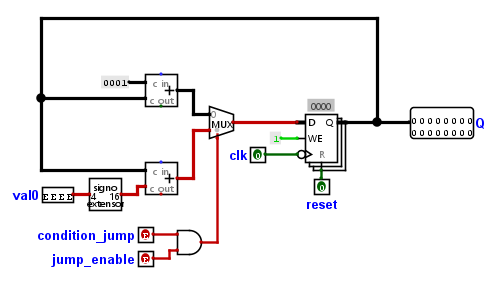
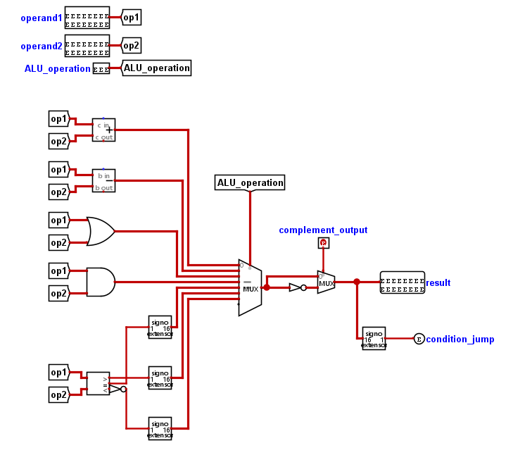
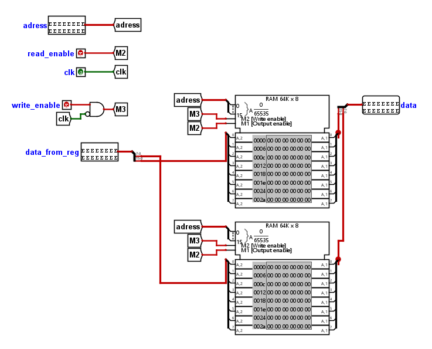
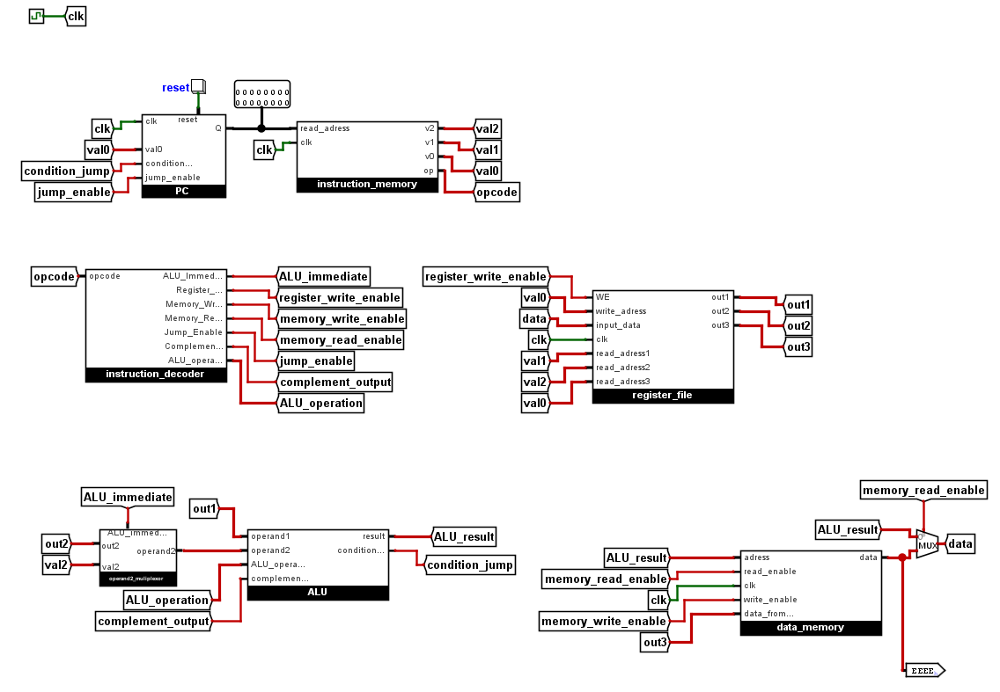

# Arquitectura e instrucciones

El procesador combina una ISA de 16 bits con un diseño monociclo organizado en subcircuitos. Esta guía recorre sus componentes y la codificación de los programas.

## Componentes

| Componente | Función |
| --- | --- |
| Contador de programa | Registro de 16 bits; avanza una instrucción o aplica un desplazamiento relativo. |
| Memoria de instrucciones | Dos RAM de 8 bits en paralelo; entrega opcode y tres campos de operandos. |
| Unidad de control | Decodifica el opcode y genera las señales de escritura, lectura, salto y operación de ALU. |
| Banco de registros | 16 registros de 16 bits; `r0` permanece en cero. |
| ALU | Suma, resta, OR, AND, comparaciones y negación de salida. |
| Memoria de datos | Dos RAM en paralelo con señales de lectura y escritura. |

El circuito principal `main` conecta los subcircuitos. Las señales de control se simplifican mediante mapas de Karnaugh.

## Codificación

Cada instrucción ocupa **16 bits**, representados por cuatro dígitos hexadecimales: un opcode de 4 bits y tres campos de 4 bits.

| Formato | Campos, de izquierda a derecha |
| --- | --- |
| R | `opcode`, `rd`, `rf1`, `rf2` |
| I | `opcode`, `rd`, `rf1`, `inmediato` |
| J | `opcode`, `desplazamiento`, `rf1`, `rf2` |

Los inmediatos se escriben en decimal en el código fuente. Para codificar valores negativos en cuatro bits, el ensamblador suma 16 antes de convertirlos a hexadecimal: por ejemplo, `-2` se representa como `e`.

## ISA

El conjunto de instrucciones reúne operaciones aritméticas, lógicas, de memoria y de control de flujo.

| Opcode | Instrucción | Operación |
| --- | --- | --- |
| `0` | `not rd, rf1, r0` | NOT bit a bit de `rf1` hacia `rd`. |
| `1` | `suma rd, rf1, rf2` | Suma de registros. |
| `2` | `resta rd, rf1, rf2` | Resta de registros. |
| `3` | `o rd, rf1, rf2` | OR bit a bit. |
| `4` | `y rd, rf1, rf2` | AND bit a bit. |
| `5` | `carga rd, rf1, rf2` | Lee la memoria en la dirección `rf1 + rf2`. |
| `6` | `almacena rd, rf1, rf2` | Escribe el contenido de `rd` en la dirección `rf1 + rf2`. |
| `7` | `sumai rd, rf1, inm` | Suma un inmediato a `rf1`. |
| `8` | `igual inm, rf1, rf2` | Salta a `PC + inm` si los registros son iguales. |
| `9` | `mayor inm, rf1, rf2` | Salta si `rf1 > rf2`. |
| `a` | `mayorig inm, rf1, rf2` | Salta si `rf1 >= rf2`. |

## Pseudoinstrucciones

Las pseudoinstrucciones permiten expresar operaciones habituales de forma abreviada. Para escribir los programas `.tsm`, usá las siguientes instrucciones equivalentes:

| Pseudoinstrucción | Expansión para el ensamblador |
| --- | --- |
| `nop` | `suma r0, r0, r0` |
| `negar r1` | `not r1, r1, r0` |
| `inc r1` | `sumai r1, r1, 1` |
| `dec r1` | `sumai r1, r1, -1` |

Por ejemplo, `inc r1` se expresa como `sumai r1, r1, 1`, tal como se utiliza en el programa de sumatoria.

## Memorias y archivos de carga

`hardware/instrucciones_memoria/` conserva dos imágenes originales con cabecera `v3.0 hex words addressed`.

Las primeras 12 posiciones de `instrucciones_memoria1` y `instrucciones_memoria2` corresponden, respectivamente, a los bytes izquierdo y derecho de las instrucciones de `compiler/bin/final.x`.

Cada archivo `.x` presenta las instrucciones como cuatro dígitos hexadecimales separados por espacios; las imágenes RAM utilizan un formato con cabecera y direcciones.

## Diagramas del procesador

### Memoria de instrucciones

Dos módulos RAM de 8 bits entregan la instrucción de 16 bits. Un separador distribuye el opcode y los campos de operandos.

### Contador de programa

El registro del PC se actualiza con el avance secuencial o el desplazamiento correspondiente a un salto.

### Unidad de control

La decodificación del opcode produce las señales que coordinan las operaciones del procesador.

### Banco de registros

Un decodificador selecciona el registro de escritura y los multiplexores seleccionan las salidas de lectura.

### Unidad aritmética lógica

La ALU reúne las operaciones aritméticas, lógicas y de comparación; las señales de control seleccionan su salida.

### Memoria de datos

Los módulos RAM trabajan en paralelo con señales de habilitación de lectura y escritura.

### Procesador completo

Los componentes se interconectan en el circuito principal mediante buses y túneles de Logisim-evolution.

